# Drawing Template Guide

How to make a technical drawing in Onshape using the Koalafied drawing template.

## Creating a Drawing

The easiest way to create a technical drawing is to click the **+** in the bottom left corner of an Onshape document, then click **Create Drawing**.

<figure>
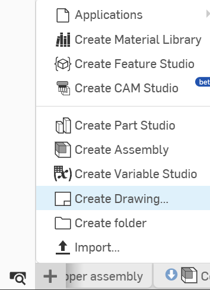
<figcaption>The + menu in the bottom left of a document</figcaption>
</figure>

This opens a popup with a few options for drawing templates.

<figure>
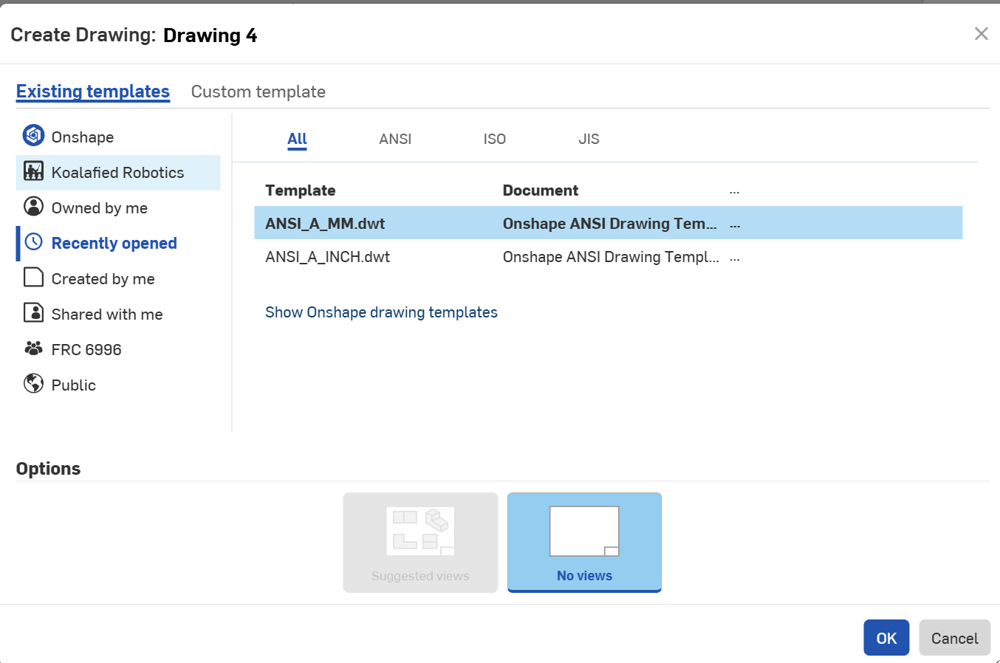
<figcaption>The Create Drawing dialog</figcaption>
</figure>

To use the Koalafied template, select **FRC 6996** and click the most recent version of the template.

<figure>
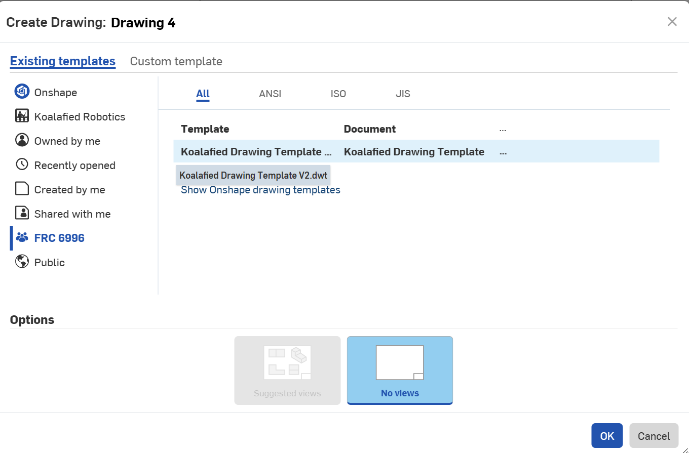
<figcaption>Selecting the Koalafied template under FRC 6996</figcaption>
</figure>

Once you click **OK**, you will get a blank copy of the template, along with a popup asking you to select a part studio or assembly. For now, close it with the **X**, as we need to set up a display state in the assembly first.

<figure>
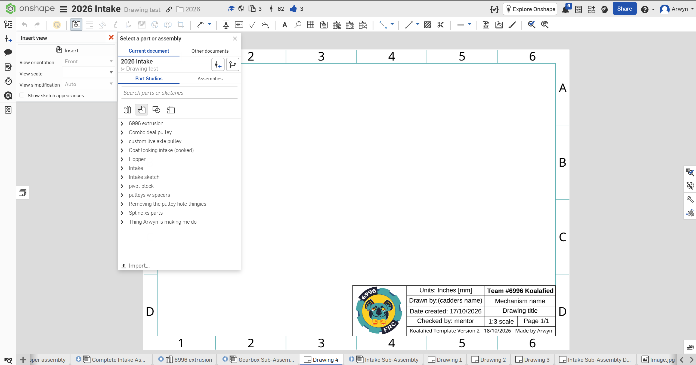
<figcaption>A blank template, with the part selection popup to close</figcaption>
</figure>

## Setting Up a Display State

A display state lets us choose which parts of an assembly or part studio are shown in a drawing. To create one, first hide everything you don't need, leaving only the parts you want in the drawing.

<figure>
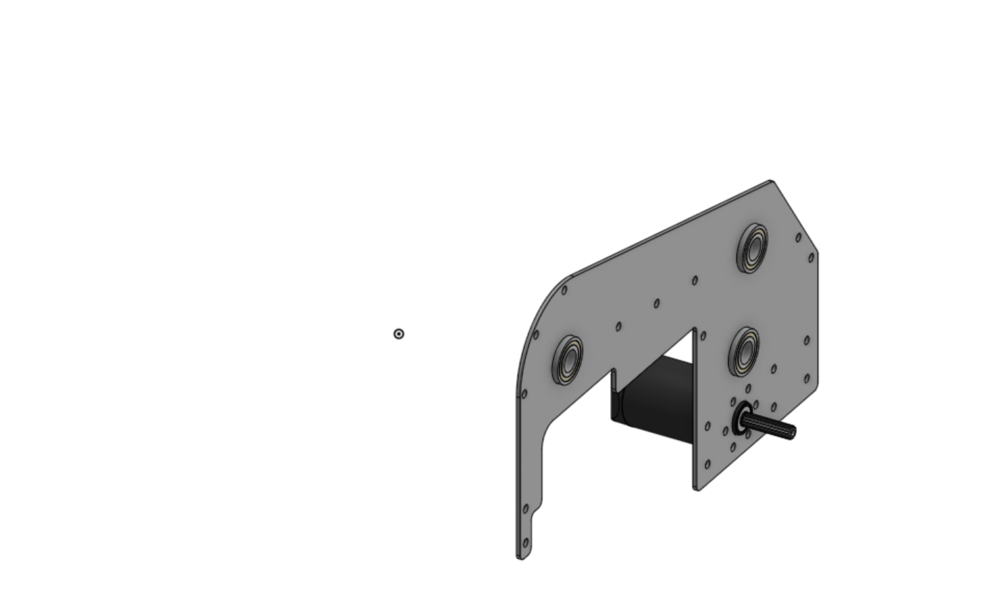
<figcaption>Only the parts we want in the drawing are left visible</figcaption>
</figure>

Then click **Display states**, create a new display state and give it a meaningful name.

<figure>
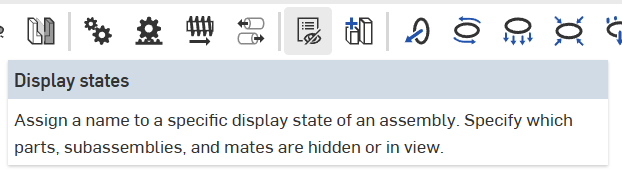
<figcaption>The Display states button in the assembly toolbar</figcaption>
</figure>

<figure>
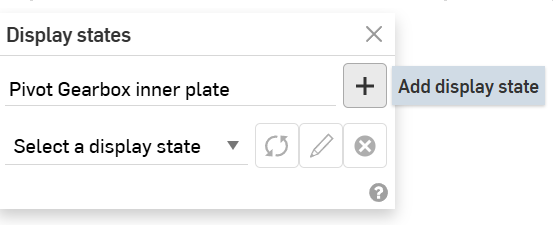
<figcaption>Naming and adding a display state</figcaption>
</figure>

## Creating the Technical Drawing

### Inserting a View

Back in your drawing, click **Insert view** and select the target assembly.

<figure>
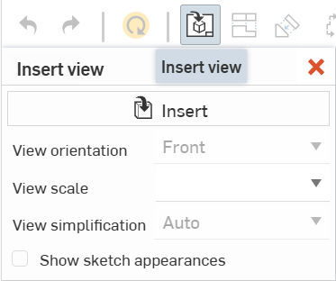
<figcaption>The Insert view tool</figcaption>
</figure>

<figure>
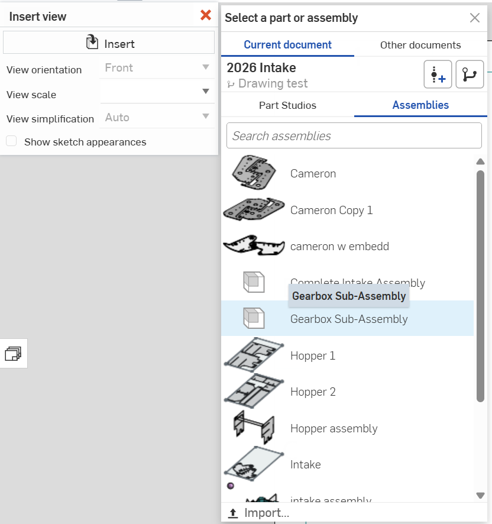
<figcaption>Selecting the assembly to draw</figcaption>
</figure>

You can then select the scale, default view orientation and display state.

<figure>
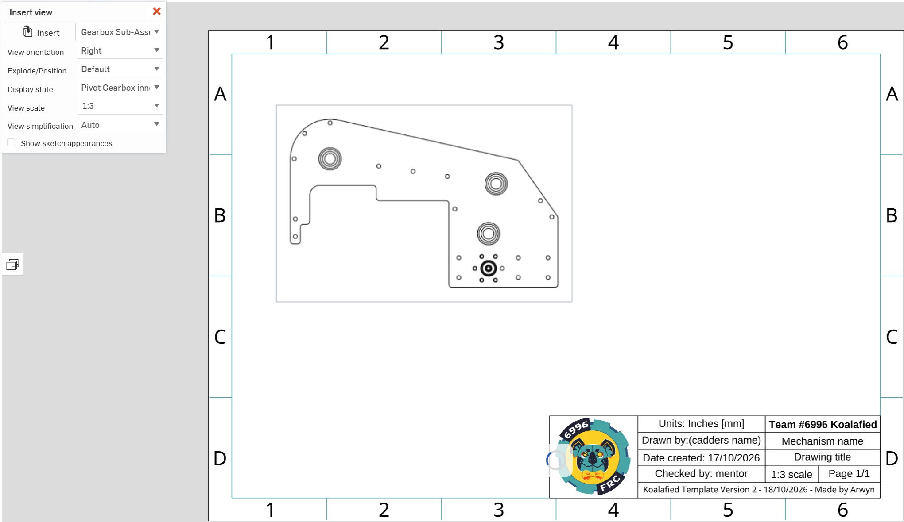
<figcaption>Setting the view orientation, display state and scale</figcaption>
</figure>

::: warning
Make sure the scale written in the title block matches the scale you chose.
:::

### Projected Views

Use the **Projected view** tool to add a few useful angles of the assembly.

<figure>
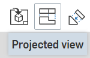
<figcaption>The Projected view tool</figcaption>
</figure>

<figure>
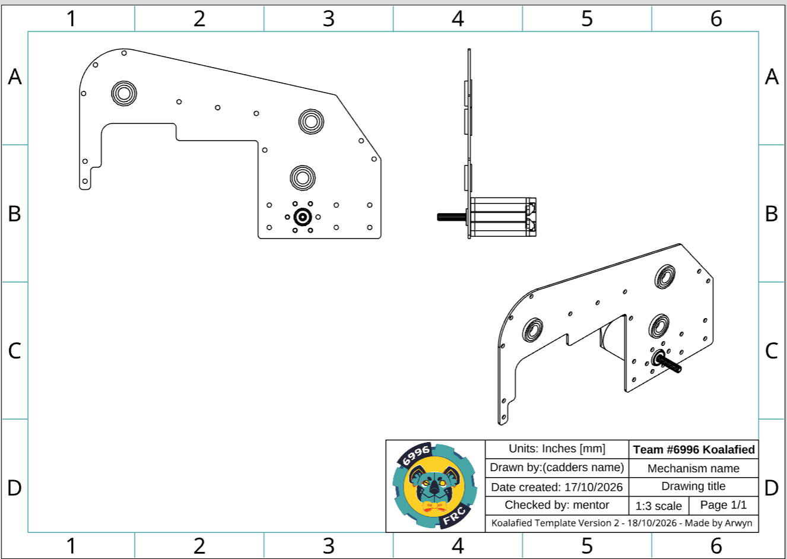
<figcaption>Front, side and isometric views</figcaption>
</figure>

### Title Block

Fill in the relevant information in the title block.

<figure>
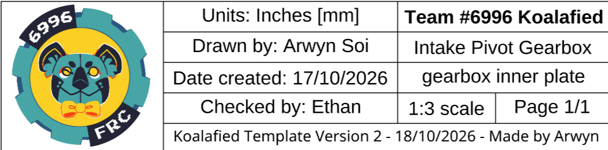
<figcaption>A filled in title block</figcaption>
</figure>

::: warning
Only fill in **Checked by** if your CAD has actually been checked by someone else and approved for manufacturing.
:::

### Dimensions

Use the dimension tool to point out any key dimensions. For example, this drawing uses dimensions to show which side of the plate the bearing's flange goes on. If there are things such as shafts or extrusions, label their dimensions as well.

<figure>
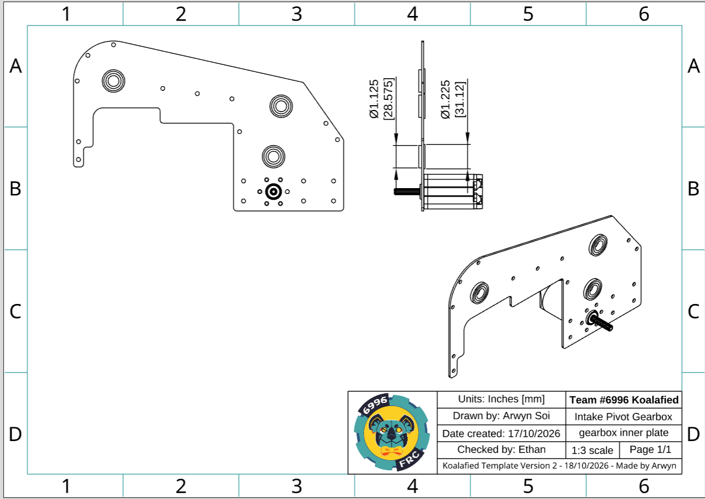
<figcaption>Dimensions showing which side the bearing flange sits on</figcaption>
</figure>

### Callouts

Click the **Callout** button and use it to label the relevant parts. Select **Name** under the **Part property** dropdown to automatically show the part's name. You can also change the text size and outline; we recommend **0.1 in** text and **no outline**.

<figure>
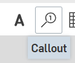
<figcaption>The Callout tool</figcaption>
</figure>

<figure>
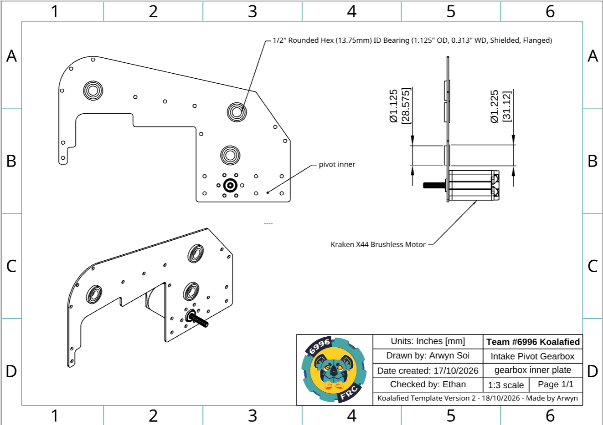
<figcaption>Callouts on the gearbox plate drawing</figcaption>
</figure>

<figure>
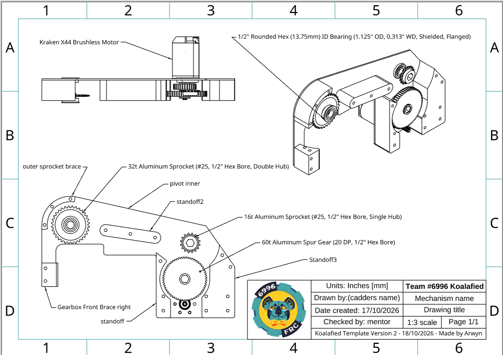
<figcaption>Callouts on a full gearbox drawing</figcaption>
</figure>

<!--
## Bill of Materials

To set up your Bill of Materials table, return to your assembly and click the BOM table button.

<figure>
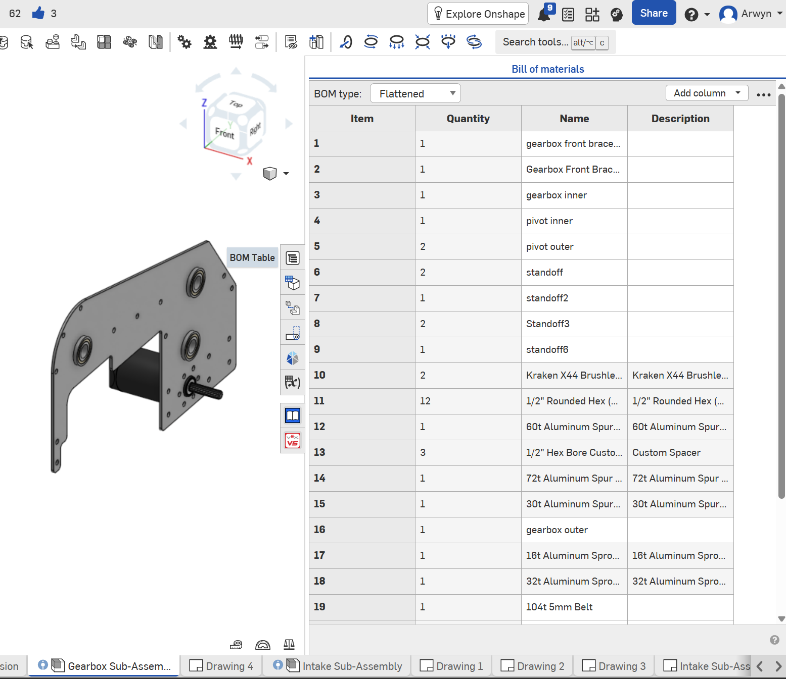
<figcaption>The BOM table in the assembly</figcaption>
</figure>
-->
