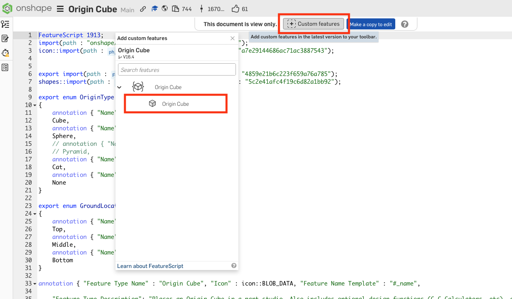

# Featurescripts
Guide on which featurescripts we recommend and how to add them. 
## How to Add One

1. Open the featurescript's document from the table below.
2. Click **Custom features** at the top of the document.
3. Click the feature to add it. It will then appear in the toolbar of your part studios.

<figure>

<figcaption>Click Custom features, then the feature you want</figcaption>
</figure>

## Recommended Feature Scripts

| Feature script | What it does | Document |
|----------------|--------------|----------|
| Origin Cube | Handy for gear C2C, belts, sprockets etc. Also gives gear, sprocket and pulley pitch diameters | [Origin Cube](https://cad.onshape.com/documents/321c197a842fc5f1a29e6621/w/fc3cdd5ca7edcd93e02f13cc/e/c66db2b954da7f29d438195a) |
| Extrude Individual | Extrudes each selected region separately | [Julia's Featurescripts](https://cad.onshape.com/documents/95c00401c440b44ad8799ef5/w/1f1ebce01a3b8eb6fa102975/e/7f62400703032fab9a7a3320) |
| Tube Converter | Converts solid extrusions to hollow tubes with hole pattern | [Julia's Featurescripts](https://cad.onshape.com/documents/95c00401c440b44ad8799ef5/w/1f1ebce01a3b8eb6fa102975/e/7f62400703032fab9a7a3320) |
| Fillet All Edges | Fillets every edge of a part at once | [Julia's Featurescripts](https://cad.onshape.com/documents/95c00401c440b44ad8799ef5/w/1f1ebce01a3b8eb6fa102975/e/7f62400703032fab9a7a3320) |
| Part Lighten | Pockets a part to reduce its weight | [Part Lighten](https://cad.onshape.com/documents/028ca8fb10baf53e1f6fce96/w/b1250a450d0ba88f0a8b1811/e/a8b9e45297aac9f5688c871d) |
| 3D Printed Mass | Estimates the mass of a 3D printed part | [Julia's Featurescripts](https://cad.onshape.com/documents/95c00401c440b44ad8799ef5/w/1f1ebce01a3b8eb6fa102975/e/7f62400703032fab9a7a3320) |
